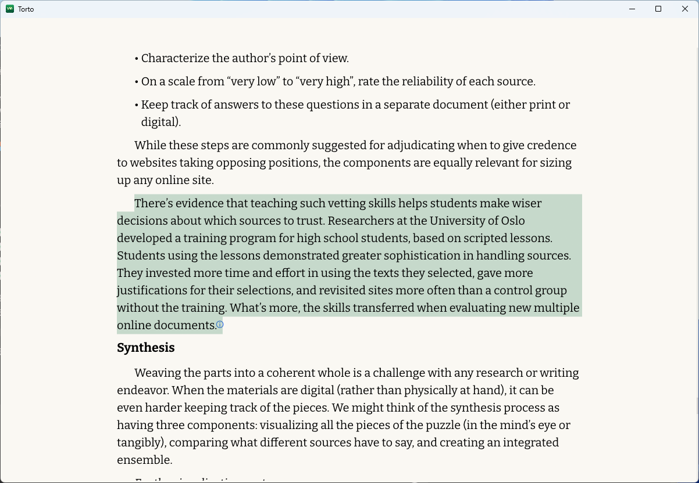

<p align="center">
  <strong>English</strong> · <a href="README.zh-CN.md">简体中文</a>
</p>

<p align="center">
  
</p>

<h1 id="torto" align="center">Torto</h1>

<p align="center">
  A local-first ebook reader built around Focus Mode—one meaningful passage at a time.<br>
  Native Rust rendering, no WebView, and your library stays under your control.
</p>

<p align="center">
  <a href="https://github.com/TortoTech/torto/releases/latest"></a>
  <a href="LICENSE"></a>
  
  
  <a href="https://linux.do"></a>
</p>

<p align="center">
  <a href="#focus-mode">Focus Mode</a> •
  <a href="#features">Features</a> •
  <a href="#screenshots">Screenshots</a> •
  <a href="#download">Download</a> •
  <a href="#privacy">Privacy</a> •
  <a href="#development">Development</a> •
  <a href="#project-status">Project status</a> •
  <a href="#license">License</a>
</p>

## About

Torto is an open-source desktop ebook reader designed around **Focus Mode**. Instead of treating a book as a static stack of pages, Focus Mode parses its structure into meaningful reading units—paragraphs, nested lists, quotations, code blocks, tables, and figures—and anchors the active unit at a steady reading line. Navigation, highlights, notes, footnotes, formula notes, table charts, translation, and AI conversations all stay attached to that context.

Classic single-column, two-column, and vertical-scroll layouts remain available whenever you want a traditional page or chapter view. Unlike browser-based readers, Torto parses, lays out, paginates, and renders content through a native Rust pipeline built on `egui`, `Parley`, `Vello`, and `wgpu`, downloading default reading fonts on demand in the background to keep the installer lightweight.

## Focus Mode

Focus Mode is Torto's default close-reading experience:

- **Read by meaning, not by page.** One semantic unit is active at a time. Lists stay grouped with their introductory paragraph, and oversized tables or media scroll internally instead of being skipped.
- **Steady reading line.** Short units start at a fixed centered baseline and expand only when needed, eliminating vertical eye jumps between paragraphs of different lengths. Choose between **Background highlight** and **Dim surroundings** for the focus style.
- **Keyboard-first passage actions.** Press `Space` to open the action toolbar, `Tab` to open the chat panel, `1` to highlight the paragraph, `2` to open the note panel, `3` to **Split by sentence**, `4` to **Visualize table** (switch between a table and its AI chart), `0` to preview a figure or table, and `Left Alt` to **Toggle footnotes / formula notes**. All shortcuts are configurable.
- **Attached context & reference previews.** Each passage has its own chat session while highlights and notes persist at durable source locations. Preview referenced figures, tables, and equations in place and cycle through multiple references in reading order.
- **PDFs in the same workflow.** Text-based PDFs reflow locally right away; scanned PDFs enter Focus Mode once cloud OCR generates a reflowable layer.

## Features

| **Feature** | **Description** | **Status** |
| --- | --- | --- |
| **Focus Mode** | Read one semantic unit at a stable centered baseline with sentence splitting (`3`), dimmed surroundings, and context-bound actions. | ✅ Core |
| **Multi-format & library** | Read DRM-free EPUB, MOBI, AZW, AZW3/KF8, FB2, FBZ, CBZ, CHM, and PDF files; browse covers, track reading statistics, and detect duplicates. | ✅ |
| **Native Rust rendering** | Parse, typeset, paginate, and render natively without a browser or WebView; download default reading fonts in the background. | ✅ |
| **Classic layouts & themes** | Switch between single-column, two-column, and vertical-scroll views with unified or book-authored styles and Light, Dark, or system themes. | ✅ |
| **Media & reference previews** | Inspect zoomable images, tables, and rendered LaTeX formulas (`0` or click); preview figures/tables/equations from inline references; copy tables as Markdown. | ✅ |
| **AI layout, formulas & charts** | Recover headings, quotes, code blocks, captions, and image-based tables; explain display-formula symbols (`Left Alt`); generate charts for suitable tables (`4`). | ✅ Optional |
| **AI reading assistant** | Chat per passage (`Tab`) or in a resizable book-chat sidebar with source citations, image Q&A (including pasted images), `/` skills, and `@` references. | ✅ Optional |
| **Translation & glossary** | Read in replacement or bilingual mode (including TOC), with optional **Expert translation** that maintains a per-book terminology glossary. | ✅ Optional |
| **PDF local reflow & OCR** | Reflow text-based PDFs locally; discover metadata/TOC with an AI agent or convert scanned PDFs via PaddleOCR and MinerU. | ✅ |
| **WebDAV sync** | Sync books, progress, highlights, notes, reading statistics, and prepared PDF reflow layouts directly through your own WebDAV storage. | ✅ Optional |
| **Feedback & updates** | Send bug reports or feature requests with screenshots and reading context in-app; verify and install MSI updates with SHA-256 on Windows. | ✅ |

### AI & PDF workflow highlights

- **Supported AI providers:** OpenAI, Anthropic, Gemini, DeepSeek, OpenRouter, SiliconFlow, xAI, Groq, Mistral, Moonshot, MiniMax, Z.ai, Ollama, llama.cpp, and custom OpenAI-compatible endpoints.
- **Smart scheduling:** AI layout and translation prioritize the active reading area in stable subsection batches and apply related updates together to avoid layout jumps. Chart labels and formula notes follow your translation target language even when body translation is off.
- **PDF intelligence:** Text PDFs reflow locally with automatic quality checks, running-header removal, and hyphenation joining. When configured, a tool-using vision model discovers book metadata, printed vs. physical page numbers, and the table of contents.

## Screenshots

### Local bookshelf

Import books, browse covers, search by title or author, review reading statistics, and continue where you left off.


### Classic two-column layout

Focus Mode is the default experience described above. Torto also provides a conventional two-column layout for readers who prefer a page-like spread.



## Download

Download the latest build from [GitHub Releases](https://github.com/TortoTech/torto/releases/latest).

| **Platform** | **Package** | **Requirements** |
| --- | --- | --- |
| Windows | `Torto-*-x86_64.msi` | 64-bit Windows 10 or 11 |
| macOS, Apple silicon | `Torto-*-macos-arm64.dmg` | macOS 15 or later |
| macOS, Intel | `Torto-*-macos-x86_64.dmg` | macOS 15 or later |

After installing, import books from the shelf and open any book in Focus Mode:
- Move between reading units with `↑` / `↓`, the mouse wheel, or the scrollbar.
- Press `Space` for actions, `Tab` for passage chat, `1` / `2` for highlights and notes, `3` to split sentences, `4` to toggle table charts, and `Left Alt` for footnotes and formula symbol notes.
- Press `Ctrl + F` to search the book and `Ctrl + ,` to configure layout, typography, translation, AI, OCR, shortcuts, and WebDAV sync.

## Privacy

- Imported books, annotations, statistics, and cached OCR/reflow data stay in Torto's local application-data directory.
- WebDAV passwords and API keys are stored in the operating system's secure credential store rather than plain configuration files.
- AI layout, translation, chat, and cloud OCR connect directly to the providers you configure. When enabled, AI layout and translation automatically send relevant text or images within the active scheduling range.
- WebDAV sync connects directly from Torto to your chosen server with no Torto-operated relay.
- Submitting in-app feedback publishes your description, optional screenshots, and the reading context shown in the dialog to a public GitHub Issue via TortoTech's feedback service. See the [privacy policy](PRIVACY.md).

## Development

Torto uses Rust `1.97.1`. The workspace package is `rebook-desktop`, producing the `Torto` application (`torto.exe` on Windows).

Run Cargo commands from the repository root so `.cargo/config.toml` applies:

```powershell
cargo run --locked -p rebook-desktop
cargo fmt --all --check
cargo clippy --workspace --all-targets --all-features -- -D warnings
cargo test --locked --workspace
```

The core reading pipeline is `parser → Reading IR → layout → renderer`. Architecture notes live in `docs/`:

- [Android preview: Rust core + Kotlin, build and migration status](docs/android.md)
- [Native rendering ADR](docs/adr-0001-native-epub-renderer.md) & [Parley evaluation](docs/parley-engine-evaluation.md)
- [AI semantic layout](docs/ai-semantic-layout.md), [batching](docs/ai-layout-batching.md), and [scheduling](docs/ai-layout-scheduling.md)
- [Native PDF reflow](docs/pdf-native-reflow.md) & [Reading statistics](docs/reading-statistics.md)
- [WebDAV sync protocol v1](docs/webdav-sync-v1.md) & [Known upstream issues](docs/known-upstream-issues.md)

<details>
<summary>Brand assets, macOS signing & feedback service</summary>

### Brand assets

`assets/logo.svg` is the shared vector master. Regenerate the master PNG, Windows installer artwork, and platform icons after editing it:

```powershell
cargo run --locked -p rebook-desktop --example generate_branding
cargo run --locked -p rebook-desktop --example generate_windows_icons
cargo run --locked -p rebook-desktop --example generate_macos_icons
```

### macOS credentials and release signing

Unit tests use an in-memory credential store and never touch the system Keychain. Production builds use the OS credential store.

The macOS installer workflow supports `MACOS_SIGNING_IDENTITY`, `MACOS_CERTIFICATE_P12_BASE64`, and `MACOS_CERTIFICATE_PASSWORD` with bundle identifier `io.github.l-chris.torto`.

### Desktop feedback service

Set `TORTO_FEEDBACK_URL` (ending in `/api/feedback`) at build time or runtime to point the feedback dialog at the deployed HTTPS endpoint. GitHub App credentials stay on the service and are never bundled with the desktop app.

</details>

## Project status

Torto is under active development. DRM-protected books are not supported. Original-layout PDFs use Classic Mode until local reflow or OCR content is available. The native renderer does not aim for full browser HTML/CSS compatibility, so complex fixed layouts, vertical writing, Ruby annotations, and interactive scripts may not render completely yet.

Report reproducible issues in [GitHub Issues](https://github.com/TortoTech/torto/issues) with the book format, screenshots, and steps (please do not upload complete copyrighted books).

## License

Torto is available under the [GNU Affero General Public License v3.0](LICENSE) (`AGPL-3.0-only`).

## Acknowledgments

- [Linux.do](https://linux.do)
